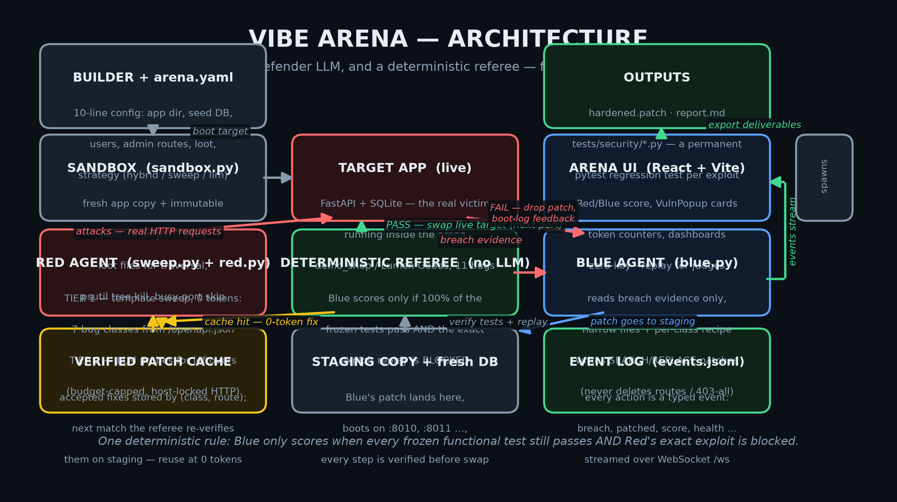
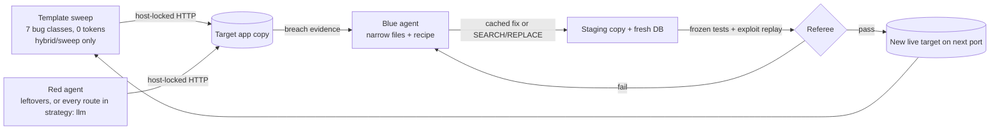
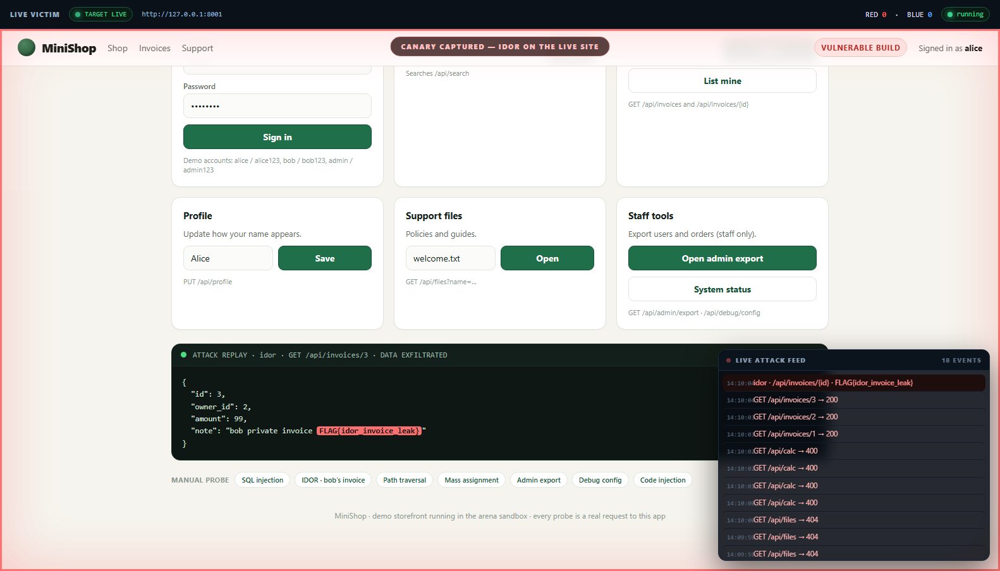
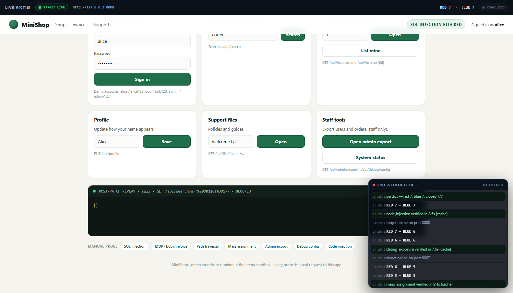

# Vibe Arena — Red vs Blue agents for AI-built apps

Compute 50 hackathon, Round 1, Domain 9 (Developer Productivity and Intelligent Automation).

## 🎬 Demo video

**[▶ Watch the demo video](https://drive.google.com/file/d/1NGZk-LoY5xjeKkrgJkz0fmTmBSfkw-JY/view?usp=sharing)**



*One picture, the whole system: the sandbox boots a real copy of the FastAPI target, Red probes it
(deterministic sweep, then LLM), Blue writes SEARCH/REPLACE patches on staging, and the referee only
accepts a fix when 100% of the frozen tests pass and the exact exploit replay is blocked. Accepted
fixes are cached and re-verified next match at 0 tokens.*
— a cold-cache live match: the Red agent attacks a real FastAPI storefront, the Blue agent writes
and verifies source patches in seconds, and the judge sees every exploit replay get `BLOCKED` inside
the arena.

You vibe-coded an app. Before you deploy it, **Red** (an attacker agent) tries to break it and
**Blue** (a defender agent) patches the source. A deterministic **referee** (no LLM) decides who
scored: Blue only scores if every frozen functional test still passes AND Red's exact exploit
is blocked. You get a hardened `.patch`, a report, and a security test per exploit.

Prior work we build on and cite: RvB (arXiv 2601.19726), OpenAI Daybreak, DARPA AIxCC, CAI (arXiv 2510.17521).
Our angle: aimed at people who ship AI-built apps with no security team and no tests.

---

## What it is, end to end

| Layer | Component | Role |
|---|---|---|
| Target | `fixtures/dev_target`, `fixtures/demo_shop` | Real FastAPI + SQLite apps run locally in a per-match sandbox |
| Attack | `arena/sweep.py`, `arena/red.py` | Deterministic 0-token template sweep + an LLM Red agent for leftovers |
| Defend | `arena/blue.py` | LLM Blue agent writing SEARCH/REPLACE source patches on staging copies |
| Judge | `arena/referee.py` | Deterministic: frozen tests must 100% pass + the exact exploit replay must be blocked |
| Memory | `patches/cache*.json` | Verified-fix cache keyed by (vuln_class, route), re-verified every match |
| Telemetry | `arena/events.py`, `arena/server.py` | Structured JSONL event log streamed over WebSocket to the React UI |
| UI | `ui/` (React + Vite) | Live arena, dashboard insights, target-app viewer, reports; zero-API-key replay mode |

The whole match is driven by a ~10-line `arena.yaml`: target app dir, seed database, test users,
admin routes, loot files, flag ownership, strategy (`hybrid | sweep | llm`), and cache path.
Changing the target = changing one file.

## Architecture



### 1. Sandbox (`arena/sandbox.py`)
- Each match boots a **fresh copy of the target app** on a dynamic port (uvicorn subprocess, próccess-tree
  cleaned with `psutil` at teardown).
- The DB is copied from an immutable `seed.db` snapshot, so matches never mutate the source website.
- `extra_paths` (images, loot files like `secret.env`) and `loot_paths` are copied so path-traversal
  findings are reproducible.
- The port allocator skips every port already in use, so a kept demo target can never collide with a
  new match; unsupported targets raise a clear `TargetBootError`.

### 2. Attack — two tiers (`arena/sweep.py`, `arena/red.py`)
**Tier 1, deterministic, 0 tokens.** The sweep reads `/openapi.json` and replays seven bug classes:
SQL injection in query params; IDOR over ids 1–10 on `/resource/{id}` routes; attacker-token calls to
`admin_routes`; path traversal with `../<loot_paths>`; mass assignment of `role` / `is_admin` on
PUT/PATCH routes; unauthenticated `debug`/`diagnostic` endpoints; and `eval`-style code execution via
`expr` / `code` / `cmd` query params. All requests run through a host-locked HTTP tool
(`arena/httptool.py`) that enforces `127.0.0.1` and registered sandbox ports **in Python code** — an
agent cannot tweet the rules away with a prompt. A strict request-count guardrail caps the sweep.

**Tier 2, agentic.** In `strategy: hybrid` (default) the LLM Red agent only probes leftovers;
in `strategy: llm` it owns discovery (`arena.llm.yaml`). Red logs in once, keeps a sliding window of
the last 6 tool steps with observations truncated to 800 chars, and carries per-agent token budgets
(`ARENA_TOKEN_BUDGET`) with cooldown/fallback in `models.yaml`.

### 3. Defend (`arena/blue.py`)
When a breach lands, Blue receives **only the files implicated by the route** (plus `main`, `db`,
`auth`) and a per-class fix recipe (e.g. "parameterize the query", "scope by `user_id`", "check
`role == admin`"), then replies with SEARCH/REPLACE edit blocks. The parser tolerates real-model
output drift (marker drift, duplicated first line, dropped decorators); staging boot-log `stderr` is
fed back to the model when a patch fails to import or boot.

### 4. Referee (`arena/referee.py`) — the honesty core
A patch is accepted only if **both** hold:
1. **100% of the frozen functional tests pass** on a staging copy with a fresh DB (tests are captured
   from the live app pre-match, then hashed — Blue cannot delete routes or 403 everyone to "pass").
2. **Red's exact exploit replay is blocked** on the patched build, re-authenticated with its own
   login (a stale stolen token cannot hide any bug).

Pass → the orchestrator swaps the patch into the live target (next port). Fail → the edits are dropped,
and the event log records an honest `blue_error` instead of an invented patch.

### 5. Verified patch cache (`patches/cache*.json`)
Every referee-accepted fix is stored keyed by `(vuln_class, route)`. Next match, the sweep finds the
same bug and Blue verifies the cached patch on staging — **again through the referee** — before
borrowing it, at **0 LLM tokens**. If it no longer applies, it is dropped and the model writes fresh.
This is why "0 tokens" is evidence, not marketing.

### 6. Telemetry & UI
Every action becomes a typed event appended to `matches/<id>/events.jsonl`
(`target_live`, `match_start`, `breach`, `blue_thinking`, `patched`, `score`, `health`,
`target_down`, `match_end`) and streamed over WebSocket (`/ws`) to the React arena, which shows
live VulnPopup cards (exploit packet → DEFENDED with time-to-patch badge), Red/Blue token counters,
a Tier-1/Tier-2 strip, and the **live victim site** — the real storefront embedded in the page
(`/target?embed=1`), where each breach is replayed against the actual app and flips to `BLOCKED`
after each accepted patch. `--replay` re-streams a recorded match with no API key, so judges can
reproduce the demo offline; dashboard insights, patches and reports are read-only JSON APIs.

## Judges: run everything with one script (Windows)

The demo target (`fixtures/demo_shop`, Lumen Goods — FastAPI + SQLite) is **built in and set as the
default**, so there is nothing to configure. Double-click:

| Script | What it does |
|---|---|
| **`run_arena.bat`** | One-click: creates the venv, installs dependencies, seeds the demo site, optionally runs the 99-test suite, then starts the server (8765) and the UI (5173) and opens your browser. **No API key needed** — the replay mode shows a full recorded match. |
| `run_tests.bat` | Just the pytest suite. |
| `demo_cold_llm.bat` | The live-LLM proof: deletes the patch cache and runs a cold match where Blue's model writes fresh patches from scratch. Needs an API key. |

To use **your own API key**, open the `.env` that `run_arena.bat` created and set:

```
ARENA_API_KEY=sk-...
ARENA_BASE_URL=https://api.openai.com/v1     # optional; any OpenAI-compatible endpoint
```

That's the entire configuration. To point the arena at **any other FastAPI app**, copy
`arena.yaml`, edit `app_dir` + `seed_db` + the login/route fields (see "Pointing it at another
FastAPI app" below), and start the server with `ARENA_CONFIG=<your>.yaml`.

Without a key the UI still lets judges watch a real recorded match end to end (zero-dependency
replay), run the manual probes on the live site, and read reports, patches and the dashboard.

## Run it manually

```powershell
python -m venv .venv
.venv\Scripts\python -m pip install -r requirements.txt
.venv\Scripts\python -m pytest tests -q            # 99 tests, about 6 min
.venv\Scripts\python -m arena.cli replay matches/sample.jsonl   # print a recorded match
```

Arena UI (replay needs no API key):

```powershell
.venv\Scripts\python -m arena.cli serve      # terminal 1, port 8765
cd ui; npm install; npm run dev              # terminal 2, open http://127.0.0.1:5173
```

### Watch the real site get attacked

`http://127.0.0.1:8765/target` is the full-screen victim view, and the **Live Arena** page embeds the
same site (`/target?embed=1`), so one screen shows the arena and the app it is fighting over. This is
the real storefront from the sandbox, not a mock: when a breach lands, the victim page posts Red's
exact request into the iframe, the storefront re-issues it with its own session, and shows the leaked
canary in red. When the referee accepts the fix the page swaps to the newly patched target and
re-sends the same request, so the site itself answers `BLOCKED` and its header chip flips to e.g.
`SQL INJECTION BLOCKED`. The **Manual probe** row replays all seven bug classes by hand, which keeps
a live demo working even with no model key.

`ARENA_KEEP_TARGET=1` before `serve` (or `--keep-target` on the CLI) leaves the patched target alive
after the verdict so those pages stay browsable. `ARENA_CONFIG` (read at import) chooses which config
the Start button loads — the demo ships `arena.demo.yaml` (demo_shop, Lumen Goods, 11 seeded
findings across the 7 classes) and `arena.llm.yaml` (LLM-only discovery).






Live match (needs an OpenAI-compatible LLM). Copy `.env.example` to `.env` and put the key in
`ARENA_API_KEY` (the file is git-ignored and loaded automatically). Provider URL and the Red/Blue
pools live in `models.yaml`; `ARENA_BASE_URL` / `ARENA_API_KEY` win over both, `ARENA_<ROLE>_MODEL`
pins one model per role. Then:

```powershell
.venv\Scripts\python -m arena.cli run --config arena.demo.yaml --yes
```

Pointing it at another FastAPI app: copy `arena.yaml`, edit `app_dir`, `seed_db`, `functional_tests`,
two normal-user logins, `sample_ids`, `admin_routes`, `extra_paths`, `loot_paths`, `flag_owners`,
`strategy` and `cache_path`. `--capture` drafts the functional tests with the LLM.

## Token strategy summary

| Tier | Cost | What it does |
|---|---|---|
| 1 — template sweep | **0 tokens** | OpenAPI-driven replay of 7 bug classes; findings labelled `template` |
| 2 — cache hit | **0 tokens** | Referee re-verifies a stored fix on staging before the swap |
| 2 — cold fix | model tokens | Blue writes a fresh SEARCH/REPLACE patch (e.g. 12.5k tokens / 9 calls on demo_shop) |

## Status (Nov 25)

Done (99 tests passing): the seven bug classes on both targets, sandbox, host-locked HTTP tool, referee
with login-aware replay, deterministic sweep, Red agent with compact history, Blue SEARCH/REPLACE
pipeline with staging verification and tolerant parsing, verified-patch cache, test capture & freeze,
exporter, orchestrator with three strategies, event log + WebSocket replay, React SOC UI with live
victim view, read-only endpoints, `.env` loading, per-role model pools, fallback & cooldown, per-agent
token budgets and per-agent usage reporting. `matches/live-20261125-171854` is the cold-cache demo_shop
run: 9/9 recorded exploits closed, 12,509 tokens across 9 LLM calls, 12/12 health.

Known test gap: `tests/test_capture.py` can flake (`WinError 145`) inside a full one-process Windows
run; it passes alone and on re-run — environment, not product.

## Pilot results

| Run | Outcome |
|---|---|
| live-20261123-203327 | 4/4 closed, 0 tokens, 0 LLM calls (warm cache, dev_target) |
| live-20261123-212404 | 4/4 closed, 3,964 tokens, 4 LLM calls (cold cache, dev_target) |
| live-20261123-213239 | 4/4 closed, 54,972 tokens, 33 LLM calls (`--explore`: no findings beyond the sweep) |
| live-20261124-081222 | 7/7 closed, 2,329 tokens, 2 LLM calls (dev_target, cold additions) |
| live-20261124-081411 | 7/7 closed, 0 tokens (warm; became `sample.jsonl`) |
| live-20261124-203557 / -204817 | LLM-only: 3/4 closed, Red ~67.6k tok / 75 calls, Blue ~8.2k / 6, 0 refusals |
| live-20261125-140157 / -140948 / -141846 | Warm-cache 7-class: 7/7 closed × 3, 0 tokens (per-class 3-run sample) |
| live-20261125-171854 | **demo_shop cold-cache: Red 9 – Blue 9, 9/9 closed, 12,509 tokens / 9 LLM calls, ttp 12–28 s** |

- **Per-class pass rate over 3 runs:** all seven classes closed in each warm match.
- **Refusal rate:** 0 of 150 Red model replies ended the loop early.
- **Tokens per agent, all recorded matches:** Red 189,861 / 302 calls, Blue 69,914 / 83 calls where
  the split is provable; 6 older runs (307,087 tokens) predate per-agent accounting and are reported
  as `—`. Full table in `docs/AUDIT-2026-11-25.md`.

## Deliverables per match

- `matches/<id>/hardened.patch` — clean unified diff for `git apply` + human review
- `matches/<id>/report.md` — findings, exploit requests, fix diffs, before/after replay proof
- `tests/security/*.py` — a permanent pytest regression test per exploit (login-aware), CI-ready

## Documentation map

Design, plans and audits live under `docs/`; the demo storyboard and script under `docs/demo/`;
screenshots in `docs/img/`; match exports (reports, patches, security tests) under `matches/<id>/`.
