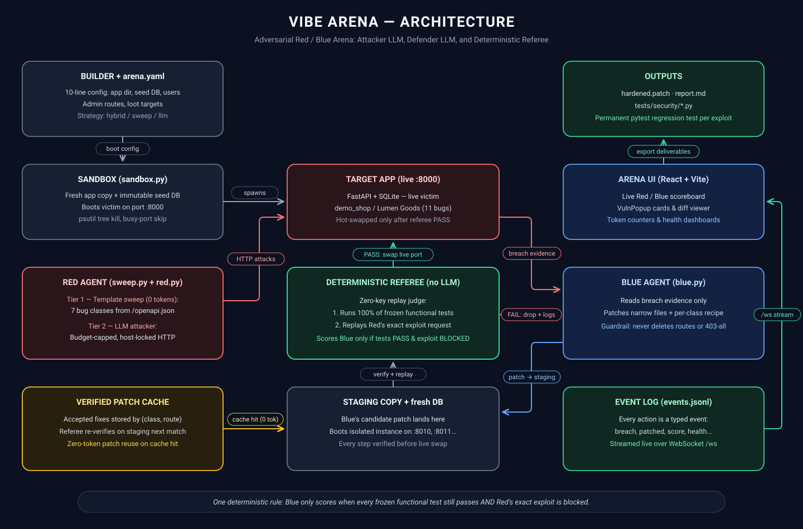
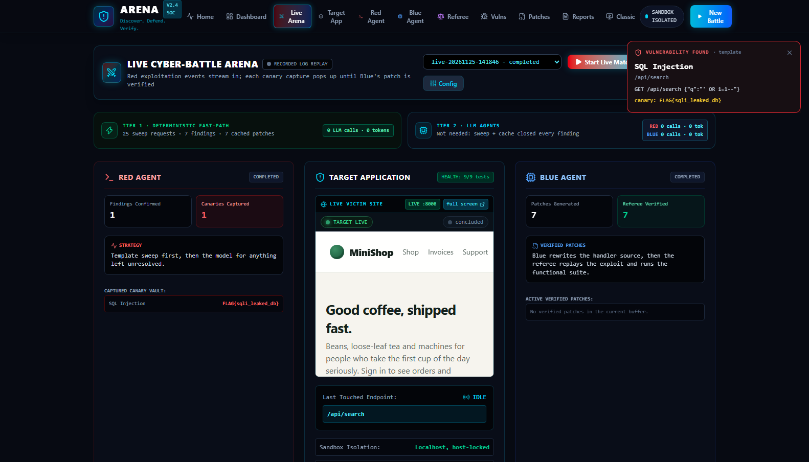

<div align="center">

# ⚔️ Vibe Arena

**Adversarial Red vs. Blue Security & Regression Harness for AI-Built Web Apps**

[](https://github.com/2005legend/redblue-arena)
[](https://python.org)
[](https://fastapi.tiangolo.com)
[](https://react.dev)
[](#verification--benchmarks)
[](#-vulnerability-coverage)

[🎬 **WATCH THE DEMO VIDEO**](https://drive.google.com/file/d/1NGZk-LoY5xjeKkrgJkz0fmTmBSfkw-JY/view?usp=sharing)
&nbsp;•&nbsp; [🚀 Quickstart (Zero-Key Replay)](#-quickstart-zero-key-replay)
&nbsp;•&nbsp; [🗺️ Architecture](#️-architecture)
&nbsp;•&nbsp; [👁️ Live Victim View](#️-live-victim-view)
&nbsp;•&nbsp; [📊 Benchmarks](#verification--benchmarks)
&nbsp;•&nbsp; [📦 Deliverables](#-deliverables-exported)

</div>

> [!TIP]
> **No API Key? Run `--replay` in 60 seconds.**
> Bundled `matches/sample.jsonl` replays a verified **7/7** match end-to-end with live breach-to-`DEFENDED`
> cards and downloadable patches — **zero LLM tokens or API keys required**. Double-click
> [`run_arena.bat`](run_arena.bat) and open the Arena UI: a recorded match plays back automatically.

> [!IMPORTANT]
> **Target Provenance & Honesty Note**
> Our initial AI-generated candidate (`targets/shop_app`) came out **secure** with no flags.
> `fixtures/dev_target` is a hand-authored FastAPI + SQLite storefront seeded with **7 representative
> AI-coding vulnerability classes**, and `fixtures/demo_shop` (Lumen Goods) carries **11 seeded
> findings** across the same 7 classes, so Red, Blue and the deterministic referee can be
> benchmarked reproducibly. Both apps are labelled as such; we never claimed they were raw AI output.

## 🎬 Demo video

**[▶ Watch the demo video](https://drive.google.com/file/d/1NGZk-LoY5xjeKkrgJkz0fmTmBSfkw-JY/view?usp=sharing)**
— a cold-cache live match: the Red agent attacks a real FastAPI storefront, the Blue agent writes and
verifies source patches in seconds, and every exploit replay ends in `BLOCKED` inside the arena.

<div align="center">



</div>

*One picture, the whole system: the sandbox boots a real copy of the FastAPI target, Red probes it
(deterministic sweep first, LLM for leftovers), Blue writes SEARCH/REPLACE patches on staging, and the
referee only accepts a fix when 100% of the frozen tests pass and the exact exploit replay is blocked.
Accepted fixes are cached and re-verified next match at 0 tokens.*

You vibe-coded an app. Before you deploy it, **Red** (an attacker agent) tries to break it and
**Blue** (a defender agent) patches the source. A deterministic **referee** (no LLM) decides who
scored. You get a hardened `.patch`, a report, and a security test per exploit.

Prior work we build on and cite: RvB (arXiv 2601.19726), OpenAI Daybreak, DARPA AIxCC, CAI (arXiv 2510.17521).
Our angle: aimed at people who ship AI-built apps with no security team and no tests.

## What it is, end to end

| Layer | Component | Role |
|---|---|---|
| Target | `fixtures/dev_target`, `fixtures/demo_shop` | Real FastAPI + SQLite apps run locally in a per-match sandbox |
| Attack | `arena/sweep.py`, `arena/red.py` | Deterministic 0-token template sweep + an LLM Red agent for leftovers |
| Defend | `arena/blue.py` | LLM Blue agent writing SEARCH/REPLACE source patches on staging copies |
| Judge | `arena/referee.py` | Deterministic: frozen tests must 100% pass + the exact exploit replay must be blocked |
| Memory | `patches/cache*.json` | Verified-fix cache keyed by (vuln_class, route), re-verified every match |
| Telemetry | `arena/events.py`, `arena/server.py` | Structured JSONL event log streamed over WebSocket to the React UI |
| UI | `ui/` (React + Vite) | Live arena, dashboard insights, target-app viewer, reports; zero-API-key replay mode |

The whole match is driven by a ~10-line `arena.yaml`: target app dir, seed database, test users,
admin routes, loot files, flag ownership, strategy (`hybrid | sweep | llm`), and cache path.
Changing the target = changing one file.

## 🚀 Quickstart (Zero-Key Replay)

The demo target (`fixtures/demo_shop`, Lumen Goods — FastAPI + SQLite) is **built in and set as the
default**, so there is nothing to configure. Windows judges: double-click **`run_arena.bat`** — it
creates the venv, installs dependencies, seeds the demo site, optionally runs the test suite, starts
the server (8765) and the UI (5173) and opens your browser.

| Script | What it does |
|---|---|
| **`run_arena.bat`** | One-click setup + launch; **no API key needed** (replay mode works out of the box) |
| `run_tests.bat` | Just the pytest suite (99 tests) |
| `demo_cold_llm.bat` | The live-LLM proof: deletes the patch cache and runs a cold match where Blue's model writes fresh patches. Needs an API key. |

To use **your own API key**, open the `.env` that `run_arena.bat` created and set:

```console
ARENA_API_KEY=sk-...
ARENA_BASE_URL=https://api.openai.com/v1     # optional; any OpenAI-compatible endpoint
```

Manual setup (any OS):

```powershell
python -m venv .venv
.venv\Scripts\python -m pip install -r requirements.txt
.venv\Scripts\python -m pytest tests -q            # 99 tests, about 6 min
.venv\Scripts\python -m arena.cli replay matches/sample.jsonl   # print a recorded match
.venv\Scripts\python -m arena.cli serve            # terminal 1, port 8765
cd ui; npm install; npm run dev                    # terminal 2, http://127.0.0.1:5173
```

<details>
<summary><b>📄 View a sample <code>arena.yaml</code> (10-line target config)</b></summary>

```yaml
app_dir: fixtures/demo_shop
app_module: app.main:app
seed_db: fixtures/demo_shop/seed.db
functional_tests: fixtures/demo_shop/tests_functional
strategy: hybrid
login: {path: /api/login, json: {username: alice, password: alice123}}
admin_routes: [/api/admin/export, /api/admin/customers]
sample_ids: {orders: 2, tickets: 1}
extra_paths: [files, secret.env, backup.sql]
loot_paths: [secret.env, backup.sql]
flag_owners: {FLAG{idor_order_receipt}: bob, FLAG{admin_export_bypass}: admin}
cache_path: patches/cache.demo.json
```
</details>

<details>
<summary><b>📄 Pointing the arena at any other FastAPI app</b></summary>

Copy `arena.yaml`, edit `app_dir`, `seed_db`, `functional_tests`, two normal-user logins,
`sample_ids`, `admin_routes`, `extra_paths`, `loot_paths` (files a traversal could reach, e.g.
`secret.txt`), `flag_owners`, `strategy` and `cache_path`. Start the server with
`ARENA_CONFIG=<your>.yaml`. `--capture` drafts the functional tests with the LLM.
</details>

## 👁️ Live Victim View

This is the real storefront from the sandbox, **not a mock**: `http://127.0.0.1:8765/target` is the
full-screen victim view, and the Live Arena page embeds the same site (`/target?embed=1`) so one
screen shows the arena and the app it is fighting over.

When a breach lands, the victim page posts Red's exact request into the iframe, the storefront
re-issues it with its own session and shows the leaked canary in red. When the referee accepts the
fix the page swaps to the newly patched target and re-sends the same request, so the site itself
answers `BLOCKED` and its header chip flips to e.g. `SQL INJECTION BLOCKED`. The **Manual probe** row
replays all seven bug classes by hand — a live demo works even with no model key.




## 🗃 Vulnerability Coverage

| # | Class | CWE | Endpoint | Severity | Fix Strategy |
| :-: | :--- | :--- | :--- | :-: | :--- |
| 1 | **SQL Injection** | `CWE-89` | `GET /api/search?q=` |  | Parameterized `?` placeholders |
| 2 | **IDOR** | `CWE-639` | `GET /api/invoices/{id}` |  | Enforce `owner == current_user` |
| 3 | **Admin Bypass** | `CWE-284` | `GET /api/admin/export` |  | Explicit `role == "admin"` guard |
| 4 | **Path Traversal** | `CWE-22` | `GET /api/files?name=` |  | `Path.resolve()` + containment check |
| 5 | **Mass Assignment** | `CWE-915` | `PUT /api/profile` |  | Allowlist updatable fields |
| 6 | **Debug Exposure** | `CWE-215` | `GET /api/debug/config` |  | Lock/disable diagnostic route |
| 7 | **Code Injection** | `CWE-94` | `GET /api/calc?expr=` |  | Replace `eval()` with a safe AST parser |

On `demo_shop` the same seven classes appear as: `GET /api/products/search`, `GET /api/orders/{id}` +
`GET /api/support/tickets/{id}`, `GET /api/admin/export` + `GET /api/admin/customers`,
`GET /api/downloads?file=` + `GET /api/attachments?name=`, `PUT /api/account` +
`PATCH /api/account/settings`, `GET /api/debug/env`, and `GET /api/widgets/preview`.

## Token strategy summary

| Tier | Cost | What it does |
|---|---|---|
| 1 — template sweep | **0 tokens** | OpenAPI-driven replay of 7 bug classes; findings labelled `template` |
| 2 — cache hit | **0 tokens** | Referee re-verifies a stored fix on staging before the swap |
| 2 — cold fix | model tokens | Blue writes a fresh SEARCH/REPLACE patch (e.g. 12.5k tokens / 9 calls on demo_shop) |

<details>
<summary><b>📄 Two-tier strategy in detail</b></summary>

**Tier 1 — deterministic fast-path (0 tokens, 0 LLM calls).** A deterministic pass reads
`/openapi.json` and replays the seven bug classes above: SQL injection in query params, IDOR over
ids 1–10 on `/resource/{id}` routes, attacker-token calls to `admin_routes`, path traversal with
`../<loot_paths>`, mass assignment of `role`/`is_admin` on PUT/PATCH routes, unauthenticated
`debug`/`diagnostic` endpoints, and `eval`-style code execution via `expr`/`code`/`cmd` query params.
In the UI these requests are labelled **template**, so the audience sees what the scripts found
versus what the model found.

**Tier 2 — LLM agents (only where Tier 1 has no answer).** In `strategy: hybrid` (default) the model
is asked only when the sweep comes back empty (or `--explore` forces a pass); `strategy: llm` skips
the sweep entirely (`arena.llm.yaml`). Red logs in once and keeps only the last 6 tool steps with
800-char observations; Blue gets only the files implicated by the route plus a per-class fix recipe.
A cold cache miss sends the finding to Blue's model, which writes a fresh SEARCH/REPLACE patch; the
referee still verifies it. `ARENA_TOKEN_BUDGET` caps each agent, with fallback and cooldown in
`models.yaml`.

The recorded `sample` match is pure Tier 1: 25 sweep requests, 7 findings, 7 cache hits,
**0 LLM calls, 0 tokens** — evidence, not a claim.
</details>

## Verification & Benchmarks

Done (99 tests passing): the seven bug classes on both targets, sandbox, host-locked HTTP tool,
referee with login-aware replay, deterministic sweep, Red agent with compact history, Blue
SEARCH/REPLACE pipeline with staging verification and tolerant parsing, verified-patch cache, test
capture & freeze, exporter, orchestrator with three strategies, event log + WebSocket replay, React
SOC UI with live victim view, read-only endpoints, `.env` loading, per-role model pools, fallback &
cooldown, per-agent token budgets and per-agent usage reporting.

| Run | Outcome |
|---|---|
| live-20261123-203327 | 4/4 closed, 0 tokens, 0 LLM calls (warm cache, dev_target) |
| live-20261123-212404 | 4/4 closed, 3,964 tokens, 4 LLM calls (cold cache, dev_target) |
| live-20261123-213239 | 4/4 closed, 54,972 tokens, 33 LLM calls (`--explore`: no findings beyond the sweep) |
| live-20261124-081222 | 7/7 closed, 2,329 tokens, 2 LLM calls (dev_target, cold additions) |
| live-20261124-081411 | 7/7 closed, 0 tokens, 0 LLM calls (warm 7-class run; became `sample.jsonl`) |
| live-20261124-203557 / -204817 | LLM-only: 3/4 closed, Red ~67.6k tok / 75 calls, Blue ~8.2k / 6, 0 refusals |
| live-20261125-140157 / -140948 / -141846 | Warm-cache 7-class: 7/7 closed × 3, 0 tokens (per-class 3-run sample) |
| live-20261125-171854 | **demo_shop cold-cache: Red 9 – Blue 9, 9/9 closed, 12,509 tokens / 9 LLM calls, ttp 12–28 s** |

- **Per-class pass rate over 3 runs:** all seven classes closed in each warm match.
- **Refusal rate:** 0 of 150 Red model replies ended the loop early.
- **Tokens per agent, all recorded matches:** Red 189,861 / 302 calls, Blue 69,914 / 83 calls where
  the split is provable; 6 older runs (307,087 tokens) predate per-agent accounting and are reported
  as `—`. Full table in `docs/AUDIT-2026-11-25.md`.

## 📦 Deliverables Exported

Per match, under `matches/<id>/`:

- `hardened.patch` — clean unified diff for `git apply` + human review
- `report.md` — findings, exploit requests, fix diffs, before/after replay proof
- `tests/security/*.py` — a permanent pytest regression test per exploit (login-aware), CI-ready

The 0-token story is honest: cached fixes are **verified by the referee on every run** before reuse.

## Documentation map

Design, plans and audits under `docs/`; demo storyboard and script under `docs/demo/`; screenshots
in `docs/img/`; match exports under `matches/<id>/`. The architecture SVG source is
`docs/img/architecture.svg`.
