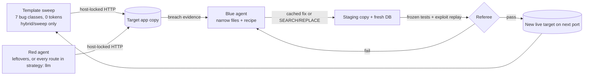

# Vibe Arena — Red vs Blue agents for AI-built apps

Compute 50 hackathon, Round 1, Domain 9 (Developer Productivity and Intelligent Automation).

You vibe-coded an app. Before you deploy it, **Red** (an attacker agent) tries to break it and
**Blue** (a defender agent) patches the source. A deterministic **referee** (no LLM) decides who
scored: Blue only scores if every frozen functional test still passes AND Red's exact exploit
is blocked. You get a hardened `.patch`, a report, and a security test per exploit.

Prior work we build on and cite: RvB (arXiv 2601.19726), OpenAI Daybreak, DARPA AIxCC, CAI (arXiv 2510.17521).
Our angle: aimed at people who ship AI-built apps with no security team and no tests.

Design: `docs/superpowers/specs/2026-11-22-vibe-arena-design.md`
Plan: `docs/superpowers/plans/2026-11-22-vibe-arena.md`

Planned next (approved 2026-11-24, **not implemented yet**): make `strategy: llm` the default with a
Blue diagnosis call, and keep the sweep + patch cache behind a new `--demo` flag. Spec and plan:
`docs/superpowers/specs/2026-11-24-llm-first-match-design.md`,
`docs/superpowers/plans/2026-11-24-llm-first-match.md`. Until that lands, the default match is still
`hybrid` and the code below describes what runs today.

## Run it

```powershell
python -m venv .venv
.venv\Scripts\python -m pip install -r requirements.txt
.venv\Scripts\python -m pytest tests -q            # 99 tests, about 6 min
.venv\Scripts\python -m arena.cli replay matches/sample.jsonl   # print a recorded match
```

Arena UI (replay needs no API key):

```powershell
.venv\Scripts\python -m arena.cli serve      # terminal 1, port 8765
cd ui; npm install; npm run dev              # terminal 2, open http://127.0.0.1:5173
```

### Watch the real site get attacked

`http://127.0.0.1:8765/target` is the full-screen victim view, and the **Live Arena** page embeds the
same site in its centre column (`/target?embed=1`), so one screen shows the arena and the app it is
fighting over. This is the real storefront from the sandbox, not a mock: when a breach lands, the
victim page posts Red's exact request into the iframe, the storefront re-issues it with its own
session, scrolls to its own response panel and shows the leaked canary in red. When the referee
accepts the fix the page swaps to the newly patched target and re-sends the same request, so the
site itself answers `BLOCKED` and its header chip flips to e.g. `SQL INJECTION BLOCKED`. The
**Manual probe** row at the bottom replays all seven bug classes by hand, which keeps a live demo
working even with no model key.

The Target App page embeds the same storefront at a larger size, and `/api/target/live` (which powers
all three views) reads the newest match log, so a match started with `python -m arena.cli run` is
visible too, and a target that outlives its process is health-checked before it is shown.
`ARENA_KEEP_TARGET=1` before `serve` (or `--keep-target` on the CLI) leaves the patched target alive
after the verdict so those pages stay browsable; without it the target is torn down at `match_end`.
A kept target holds its port, so the allocator now skips ports that are already in use.
Set `ARENA_CONFIG=arena.llm.yaml` in the shell before `serve` to choose which config the Start
button loads (it is read at import time).


Live match (needs an OpenAI-compatible LLM). Copy `.env.example` to `.env` and put the key in
`ARENA_API_KEY` (the file is git-ignored and loaded automatically). Provider URL and the Red/Blue
pools live in `models.yaml`: the repo ships the FreeLLM router on Tailscale
(`http://100.93.147.107:3001/v1`, key env `FREELLMAPI_API_KEY`), with Red on fast models and Blue
on the strongest code model. A model file may also set `base_url` and `api_key_env` (the key itself
never lives in it); `ARENA_BASE_URL` / `ARENA_API_KEY` win over both. `ARENA_MODELS_FILE` points at a
different model file, and `ARENA_<ROLE>_MODEL` pins one model per role, with `ARENA_MODEL` as the
last resort. The Tailscale host must be online (`tailscale status`,
`curl http://100.93.147.107:3001/api/ping`); list usable ids with
`curl -H "Authorization: Bearer $FREELLMAPI_API_KEY" http://100.93.147.107:3001/v1/models`.
Then:

```powershell
.venv\Scripts\python -m arena.cli run --config arena.yaml --yes
```

Pointing it at another FastAPI app: copy `arena.yaml` and edit `app_dir`, `seed_db`, `functional_tests`,
two normal-user logins, `sample_ids`, `admin_routes`, `extra_paths`, `loot_paths` (files a traversal
could reach, e.g. `secret.txt`), `flag_owners`, `strategy` and `cache_path`. `--capture` drafts the
functional tests with the LLM (you approve them unless `--yes`).

## Token strategy: two tiers

Matches are cheap by default. Cheapest first, most expensive last:

**Tier 1 — deterministic fast-path (0 tokens, 0 LLM calls).** A deterministic pass reads
`/openapi.json` and replays the seven bug classes we always test: SQL injection in query params,
IDOR over ids 1–10 on `/resource/{id}` routes, attacker-token calls to `admin_routes`, path
traversal with `../<loot_paths>`, mass assignment of `role`/`is_admin` on PUT/PATCH routes,
unauthenticated `debug`/`diagnostic` endpoints, and `eval`-style code execution through
`expr`/`code`/`cmd` query params.
1. **Template sweep.** In the UI these requests and breaches are labelled **template**, so the
   audience can see what the scripts found versus what the model found.
2. **Blue reads less and reuses fixed patches.** Blue gets only the files implicated by the route
   (plus `main`, `db`, `auth`) and a per-class fix recipe. A verified SEARCH/REPLACE edit is stored
   in `patches/cache.json`, keyed by class + route (not by token or payload); the next match verifies
   it on staging before spending any tokens, and drops it if it no longer applies.

The recorded `sample` match is pure Tier 1: 25 sweep requests, 7 findings, 7 cache hits,
**0 LLM calls, 0 tokens**. The Arena page reads those counters from the event log and shows both
tiers side by side, so this is evidence rather than a claim.

**Tier 2 — LLM agents (only where Tier 1 has no answer).**
3. **LLM Red only for leftovers.** In `strategy: hybrid` (default) the model is asked only when the
   sweep comes back empty (or `--explore` forces a pass). `strategy: sweep` never calls Red's LLM;
   `strategy: llm` skips the sweep entirely and is what `arena.llm.yaml` uses. Red also logs in once
   before speaking and keeps only the last 6 tool steps, with each observation truncated to 800
   chars plus an explicit `FLAGS FOUND:` line.
4. **Cold cache or new codebase.** A cache miss (new route or deleted cache) sends the finding to
   Blue's model, which writes a fresh SEARCH/REPLACE patch; the referee still verifies it.

Override per run: `--strategy hybrid|sweep|llm`, `--explore`. The UI shows `SWEEP-FIRST`,
`TEMPLATE SWEEP` or `LLM RED`, plus LLM round-trips, tokens and cache hits from the log.

### Cold-cache demo (shows the AI working)

Tier 1 alone can look like "just a script", so record one Tier 2 match for the video:

```powershell
# 1. Make the cache cold so Blue must write a fresh patch
Remove-Item patches\cache.json

# 2. Sweep finds the bugs, --explore also runs Red's LLM, Blue has no cached fix
.venv\Scripts\python -m arena.cli run --config arena.yaml --yes --explore
```

Play back both matches: the sample shows 0 LLM calls / 0 tokens, the cold run shows the model's
reasoning and a newly generated diff. `ARENA_MODEL_COOLDOWN` (seconds, `0` = retry immediately)
controls how long a failing model rests between fallback attempts.

### LLM-only match (`arena.llm.yaml`)

For a run where the models do the discovery too, use the shipped LLM-only config: `strategy: llm`
(no sweep) and its own cache file, `patches/cache.llm.json`. Delete that file for a fully cold run,
so Red must find the bugs and Blue must write every patch:

```powershell
Remove-Item patches\cache.llm.json -ErrorAction SilentlyContinue
.venv\Scripts\python -m arena.cli run --config arena.llm.yaml --yes
```

The shipped `matches/sample.jsonl` is still the 0-token sweep recording above (the offline path for
judges); the LLM-only run is the one to record when the audience should see the models reasoning.

## Architecture



## Status (Nov 25)

Done (99 tests, all passing on Nov 25): dev target with 7 seeded bug classes (SQL injection, IDOR, admin bypass,
path traversal, mass assignment, debug endpoint exposure, eval code injection), sandbox (per-port process, DB copy, extra data paths, psutil tree kill, busy-port skipping for a kept demo target), host-locked HTTP tool,
referee with login-aware exploit replay (a stale token cannot hide a bug), deterministic template sweep
(OpenAPI-driven, labelled in the UI), Red LLM agent with one-time pre-login, compact observations and capped
history, Blue SEARCH/REPLACE pipeline with staging verification (staging is always torn down, even on
errors) and tolerant parsing of real-model output (marker drift, duplicated first line, dropped route
decorators), narrow file selection, per-class fix recipes, boot-log feedback (the staging process
stderr is fed back to the model when a patch fails to import or boot), and a verified-patch cache, test capture and freeze,
exporter (security tests log in again instead of reusing a token), orchestrator with
`hybrid|sweep|llm` strategies, event log, WebSocket server with replay, React SOC UI with live
vulnerability cards (the exploit request and canary pop on screen, then flip to DEFENDED with the
patch time when the referee accepts Blue's fix), a Tier 1 / Tier 2 counter strip read from the log,
read-only SOC endpoints (`/api/battles`, `/api/dashboard/stats`, `/api/vulnerabilities`, `/api/patches`,
`/api/battles/{id}/report`, `/api/target/config/status`, `/api/target/live`) over `arena/site_api.py`
(outcomes come from the referee summary, so Red re-testing a known bug does not read as an unpatched
finding, and the dashboard counts a re-tested bug once), a live victim view (`/target`, embedded in
the Target App page and in the Arena centre column) that replays each real breach inside the actual
storefront and each accepted fix against the patched target (the site's own response panel shows the
leak, then `BLOCKED`, and its header chip follows), `ARENA_KEEP_TARGET=1` / `--keep-target` to leave
the patched target browsable after the verdict, `live_target()` so a CLI-run or kept target is found
from the newest match log, a log without `match_end` older than 10 minutes reading as
`interrupted` instead of `running`, `.env` loading, per-role model pools
(`models.yaml` / `ARENA_MODELS_FILE` / `ARENA_<ROLE>_MODEL`) with a model file able to set
`base_url`/`api_key_env`, fallback and cooldown (`ARENA_MODEL_COOLDOWN`), per-agent token budget
(`ARENA_TOKEN_BUDGET`), and per-agent usage reporting (Red and Blue LLM calls and tokens: recorded
directly in new logs, inferred from `blue_thinking` events / the total for older ones, "—" when a
split cannot be proven).

Known test gap (Nov 25): the suite is green at 99/99, but
`tests/test_capture.py::test_capture_filters_cross_user_and_failing` can fail inside a full
one-process Windows run with `WinError 145` while pytest's temp directory is being cleaned; it passes
alone and on a re-run, so it is an environment flake, not a product bug. The three stale
`match_end`-is-last assertions in `tests/test_orchestrator.py` were fixed on Nov 25 (the target now
starts before `match_start`, and `target_down` precedes `match_end`).

NOT done yet:
1. **Recorded matches.** Four runs exported from the UI / CLI: `matches/live-20261123-203327` (warm
   cache, 4 classes: 4/4 closed, 18 sweep requests, 4 cache hits, 0 LLM calls, 0 tokens),
   `matches/live-20261123-212404` (cold cache, 4 classes: 4/4 closed, Blue wrote 4 fresh patches in
   3,964 tokens / 4 LLM calls), `matches/live-20261123-213239` (hybrid `--explore`: Red's LLM made
   33 calls / ~71 extra requests but added no unique findings beyond the sweep's four) and
   `matches/live-20261124-081222` (7 classes: 7/7 closed, 5 cache hits, 2 fresh Blue patches,
   2,329 tokens / 2 LLM calls). `matches/live-20261124-081411` is the final warm 7-class run that
   became `sample.jsonl`: 7/7 closed, 25 sweep requests, 7 cache hits, 0 LLM calls, 0 tokens, fixes
   in 6.5–7.4 s, 9/9 health. Still to record: per-class success over 3 runs and refusal rate.
2. **Demo target honesty.** We asked a fresh AI agent for a shop app with a plain prompt and it came out secure
   (`targets/shop_app/GENERATION_LOG.md`). So `fixtures/dev_target` is described as "representative of common
   AI-generated bugs", never as "unedited AI output". Try other tools or prompts if you want a natural one.
3. `matches/sample.jsonl` is now a **real recorded match** (sweep-first, all seven bugs, seven cached
   fixes, 0 tokens). The replay server marks every replayed `match_start` as `sample`, so the UI always
   shows "SAMPLE REPLAY"; re-record it after changing the target or cache.
4. Demo video, PPT (outline in `docs/presentation/outline.md`, script in `docs/demo/script.md`), and who does
   what in `docs/TEAM_TASKS.md`.
5. Rules check: ask the organisers whether code written before Nov 23 is allowed.

## Pilot results

| Run | Outcome |
|---|---|
| live-20261122-212025 | 0–0, 75k tokens. Capture kept 1 of 6 tests; Red never logged in successfully. |
| live-20261122-213906 | 0–0, 25k tokens. Same login failure; fixed afterwards. |
| live-20261122-214210 | 6/6 health. Red breached SQLi, admin bypass and IDOR; Blue patched all three in 6–60 s and health stayed 6/6. Interrupted before a clean export. |
| live-20261123-203327 | 4/4 closed, 0 tokens, 0 LLM calls. Warm cache: 18 sweep requests, 4 findings, 4 cached fixes in 5.2–5.4 s, 6/6 health, exported. |
| live-20261123-212404 | 4/4 closed, 3,964 tokens, 4 LLM calls. Cold cache (Blue's real LLM): 18 sweep requests, 4 findings, fresh patches in 6.4–8.0 s, 6/6 health, exported. |
| live-20261123-213239 | 4/4 closed, 54,972 tokens, 33 LLM calls, 4 cache hits. Hybrid `--explore`: Red's LLM made ~71 extra requests but found nothing new beyond the sweep; Blue's cached fixes in 6.6–7.1 s, exports written. |
| live-20261123-221117 | 4/7 closed, 0 tokens. Cache warm for 4 classes; the FreeLLM host went offline, so the 3 new classes ended in `blue_error` (honest log, no invented patches). |
| live-20261124-080946 | 5/7 closed, 21,768 tokens, 15 LLM calls. Fully cold 7-class run: mass assignment and code injection failed fresh generation (missing import / broken functional test); fixed the recipes afterwards. |
| live-20261124-081222 | 7/7 closed, 2,329 tokens, 2 LLM calls, 5 cache hits. Cold additions after the recipe fix: Blue wrote mass-assignment and code-injection patches from scratch in one round-trip each. |
| live-20261124-081411 | 7/7 closed, 0 tokens, 0 LLM calls. Warm cache: 25 sweep requests, 7 findings, 7 cached fixes in 6.5–7.4 s, 9/9 health. Copied to `matches/sample.jsonl`. |

Still to record: pass rate per class over 3 runs, refusal rate, tokens per match with the budget guard on.
