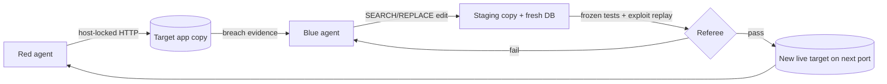

# Vibe Arena — Red vs Blue agents for AI-built apps

Compute 50 hackathon, Round 1, Domain 9 (Developer Productivity and Intelligent Automation).

You vibe-coded an app. Before you deploy it, **Red** (an attacker agent) tries to break it and
**Blue** (a defender agent) patches the source. A deterministic **referee** (no LLM) decides who
scored: Blue only scores if every frozen functional test still passes AND Red's exact exploit
is blocked. You get a hardened `.patch`, a report, and a security test per exploit.

Prior work we build on and cite: RvB (arXiv 2601.19726), OpenAI Daybreak, DARPA AIxCC, CAI (arXiv 2510.17521).
Our angle: aimed at people who ship AI-built apps with no security team and no tests.

Design: `docs/superpowers/specs/2026-11-22-vibe-arena-design.md`
Plan: `docs/superpowers/plans/2026-11-22-vibe-arena.md`

## Run it

```powershell
python -m venv .venv
.venv\Scripts\python -m pip install -r requirements.txt
.venv\Scripts\python -m pytest tests -q            # 28 tests, about 45 s
.venv\Scripts\python -m arena.cli replay matches/sample.jsonl   # print a recorded match
```

Arena UI (replay needs no API key):

```powershell
.venv\Scripts\python -m arena.cli serve      # terminal 1, port 8765
cd ui; npm install; npm run dev              # terminal 2, open http://127.0.0.1:5173
```

Live match (needs an OpenAI-compatible LLM). Copy `.env.example` to `.env`, fill in
`ARENA_BASE_URL`, `ARENA_API_KEY`, `ARENA_MODEL` (the file is git-ignored and loaded automatically), then:

```powershell
.venv\Scripts\python -m arena.cli run --config arena.yaml --yes
```

Pointing it at another FastAPI app: copy `arena.yaml` and edit `app_dir`, `seed_db`, `functional_tests`,
two normal-user logins, `sample_ids`, `admin_routes`. `--capture` drafts the functional tests with the LLM
(you approve them unless `--yes`).

## Architecture



## Status (Nov 22, evening)

Done and tested (32 tests): dev target with 4 seeded bug classes (SQL injection, IDOR, admin bypass, path
traversal), sandbox (per-port process, DB copy, extra data paths, psutil tree kill), host-locked HTTP tool,
referee, Red agent, Blue SEARCH/REPLACE pipeline with staging verification, test capture and freeze, exporter,
orchestrator, event log, WebSocket server with replay, React arena UI, `.env` loading.

NOT done yet:
1. **Live pilot.** Never run against a real LLM. Fill `.env`, run `python -m arena.cli run --yes`, and record
   valid tool calls, refusals, Red success per class (pass bar 2 of 3) and tokens per match under "Pilot results".
2. **Demo target honesty.** We asked a fresh AI agent for a shop app with a plain prompt and it came out secure
   (`targets/shop_app/GENERATION_LOG.md`). So `fixtures/dev_target` is described as "representative of common
   AI-generated bugs", never as "unedited AI output". Try other tools or prompts if you want a natural one.
3. `matches/sample.jsonl` is a hand-authored sample for UI work (diffs are real, events are not a live run).
   Replace it with a real recorded match after the pilot.
4. Demo video, PPT (outline in `docs/presentation/outline.md`, script in `docs/demo/script.md`), and who does
   what in `docs/TEAM_TASKS.md`.
5. Rules check: ask the organisers whether code written before Nov 23 is allowed.

## Pilot results

(empty)
