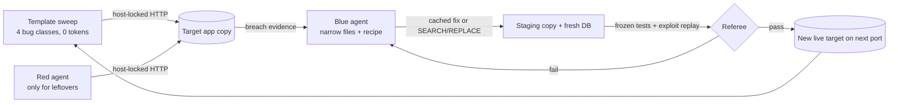

# Vibe Arena — Red vs Blue agents for AI-built apps

Compute 50 hackathon, Round 1, Domain 9 (Developer Productivity and Intelligent Automation).

You vibe-coded an app. Before you deploy it, **Red** (an attacker agent) tries to break it and
**Blue** (a defender agent) patches the source. A deterministic **referee** (no LLM) decides who
scored: Blue only scores if every frozen functional test still passes AND Red's exact exploit
is blocked. You get a hardened `.patch`, a report, and a security test per exploit.

Prior work we build on and cite: RvB (arXiv 2601.19726), OpenAI Daybreak, DARPA AIxCC, CAI (arXiv 2510.17521).
Our angle: aimed at people who ship AI-built apps with no security team and no tests.

Design: `docs/superpowers/specs/2026-11-22-vibe-arena-design.md`
Plan: `docs/superpowers/plans/2026-11-22-vibe-arena.md`

## Run it

```powershell
python -m venv .venv
.venv\Scripts\python -m pip install -r requirements.txt
.venv\Scripts\python -m pytest tests -q            # 73 tests, about 4 min
.venv\Scripts\python -m arena.cli replay matches/sample.jsonl   # print a recorded match
```

Arena UI (replay needs no API key):

```powershell
.venv\Scripts\python -m arena.cli serve      # terminal 1, port 8765
cd ui; npm install; npm run dev              # terminal 2, open http://127.0.0.1:5173
```

Live match (needs an OpenAI-compatible LLM). Copy `.env.example` to `.env`, fill in
`ARENA_BASE_URL`, `ARENA_API_KEY`, `ARENA_MODEL` (the file is git-ignored and loaded automatically), then:

```powershell
.venv\Scripts\python -m arena.cli run --config arena.yaml --yes
```

Pointing it at another FastAPI app: copy `arena.yaml` and edit `app_dir`, `seed_db`, `functional_tests`,
two normal-user logins, `sample_ids`, `admin_routes`, `extra_paths`, `loot_paths` (files a traversal
could reach, e.g. `secret.txt`), `flag_owners`, `strategy` and `cache_path`. `--capture` drafts the
functional tests with the LLM (you approve them unless `--yes`).

## Token strategy

Matches are cheap by default. Cheapest first, most expensive last:

1. **Template sweep (0 tokens).** A deterministic pass reads `/openapi.json` and replays the four
   bug classes we always test: SQL injection in query params, IDOR over ids 1–10 on
   `/resource/{id}` routes, attacker-token calls to `admin_routes`, and path traversal with
   `../<loot_paths>`. In the UI these requests and breaches are labelled **template**, so the
   audience can see what the scripts found versus what the model found.
2. **LLM Red only for leftovers.** In `strategy: hybrid` (default) the model is asked only when the
   sweep comes back empty (or `--explore` forces a pass). `strategy: sweep` never calls Red's LLM;
   `strategy: llm` is the old pure-agent mode. Red also logs in once before speaking and keeps only
   the last 6 tool steps, with each observation truncated to 800 chars plus an explicit
   `FLAGS FOUND:` line.
3. **Blue reads less and reuses fixed patches.** Blue gets only the files implicated by the route
   (plus `main`, `db`, `auth`) and a per-class fix recipe. A verified SEARCH/REPLACE edit is stored
   in `patches/cache.json`, keyed by class + route (not by token or payload); the next match verifies
   it on staging before spending any tokens, and drops it if it no longer applies.

Override per run: `--strategy hybrid|sweep|llm`, `--explore`. The UI shows `SWEEP-FIRST`,
`TEMPLATE SWEEP` or `LLM RED`, plus LLM round-trips and cache hits on the end screen.

## Architecture



## Status (Nov 22, evening)

Done and tested (73 tests): dev target with 4 seeded bug classes (SQL injection, IDOR, admin bypass, path
traversal), sandbox (per-port process, DB copy, extra data paths, psutil tree kill), host-locked HTTP tool,
referee with login-aware exploit replay (a stale token cannot hide a bug), deterministic template sweep
(OpenAPI-driven, labelled in the UI), Red LLM agent with one-time pre-login, compact observations and capped
history, Blue SEARCH/REPLACE pipeline with staging verification (staging is always torn down, even on
errors), narrow file selection, per-class fix recipes and a verified-patch cache, test capture and freeze,
exporter (security tests log in again instead of reusing a token), orchestrator with
`hybrid|sweep|llm` strategies, event log, WebSocket server with replay, React arena UI with live
vulnerability cards (the exploit request and canary pop on screen, then flip to DEFENDED with the
patch time when the referee accepts Blue's fix), `.env` loading, per-agent token budget
(`ARENA_TOKEN_BUDGET`).

NOT done yet:
1. **Clean recorded match.** Pilots have run (see "Pilot results"), but none produced a full exported match.
   Re-run `python -m arena.cli run --yes` and record valid tool calls, refusals, Red success per class
   (pass bar 2 of 3) and tokens per match.
2. **Demo target honesty.** We asked a fresh AI agent for a shop app with a plain prompt and it came out secure
   (`targets/shop_app/GENERATION_LOG.md`). So `fixtures/dev_target` is described as "representative of common
   AI-generated bugs", never as "unedited AI output". Try other tools or prompts if you want a natural one.
3. `matches/sample.jsonl` is now a **real recorded match** (sweep-first, all four bugs, four cached fixes,
   0 tokens). The replay server marks every replayed `match_start` as `sample`, so the UI always shows
   "SAMPLE REPLAY"; re-record it after changing the target or cache.
4. Demo video, PPT (outline in `docs/presentation/outline.md`, script in `docs/demo/script.md`), and who does
   what in `docs/TEAM_TASKS.md`.
5. Rules check: ask the organisers whether code written before Nov 23 is allowed.

## Pilot results

| Run | Outcome |
|---|---|
| live-20261122-212025 | 0–0, 75k tokens. Capture kept 1 of 6 tests; Red never logged in successfully. |
| live-20261122-213906 | 0–0, 25k tokens. Same login failure; fixed afterwards. |
| live-20261122-214210 | 6/6 health. Red breached SQLi, admin bypass and IDOR; Blue patched all three in 6–60 s and health stayed 6/6. Interrupted before a clean export. |

Still to record: pass rate per class over 3 runs, refusal rate, tokens per match with the budget guard on.
